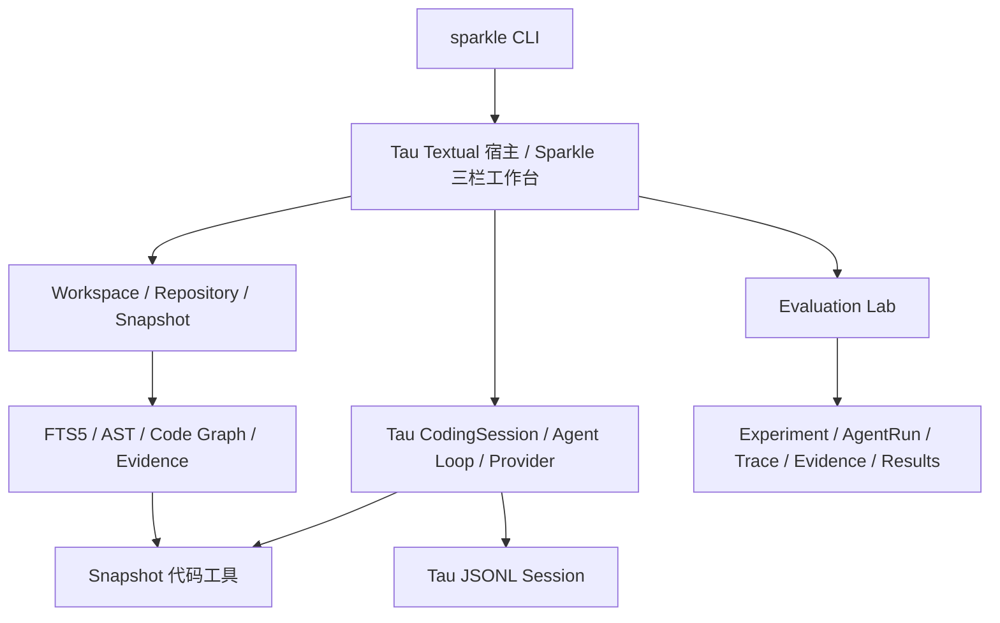

# Sparkle Navigator

基于 **Tau 源码 Fork** 的代码库理解、编程与 Agent 评测工作台。面向阅读陌生 Python 项目的场景，将固定代码快照、检索证据、Agent 对话和评测结果放在一个终端界面中。


## 为什么做这个项目

代码问答需要回答“依据的是哪个版本、哪些代码”；Agent 调试还需要知道“调用了什么工具、过程如何保存、结果如何比较”。Sparkle 用不可变 Repository Snapshot 固定证据来源，并用独立的 Evaluation Lab 保存实验与运行记录，避免把一次聊天结果当成可复现的评测结论。

## 上游能力与本项目增量

| 部分 | 来源与本项目工作 |
| --- | --- |
| Provider、Agent Loop、CodingSession、工具、JSONL Session、Compaction、Textual 宿主 | 复用 Tau v0.4.4，并在同一源码树中扩展必要接缝 |
| Repository / Snapshot / Working Copy | 新增导入、固定文件哈希、持久化与工作副本管理 |
| 代码库上下文引擎 | 新增 SQLite FTS5、Python AST 符号、静态 Code Graph、证据查询与可选语义检索 |
| Tool Profile 与授权 | 新增 Explain / Coding 配置档、仓库信任及工具调用审批策略 |
| Memory / Context / MCP | 新增项目事实、学习者资料、预算化上下文和 MCP 适配模块；模块存在不代表全部已接入默认聊天链路 |
| Evaluation Lab | 新增 Experiment / AgentRun / Trace / Evidence 持久化、重复运行、比较与报告；提供 NativeBackend、Inspect AI、HTTP Agent 和 Ragas 接缝 |
| 产品 TUI | 基于 Tau 原有界面改造 Workspace / Agent / Evaluation 常驻三栏布局 |


## 架构与一条实际使用链路



聊天 Session 与评测 Experiment 是不同生命周期。Ground Truth 只供评分使用，不应作为答案提示交给被测 Agent。静态调用图是分析线索，不能代替动态执行证明。

## 安装与启动

需要 **Python 3.12+、Git**，建议使用至少 120 列的终端。以下以已经下载或克隆到本地的源码目录为起点；安装会从配置的 Python 包源获取依赖，首次安装需要网络。

```powershell
python -m venv .venv
.\.venv\Scripts\python.exe -m pip install -e ".[dev]"
.\.venv\Scripts\sparkle.exe --help
.\.venv\Scripts\sparkle.exe
```

激活虚拟环境后可直接使用 `sparkle`。从其他项目目录启动时，可使用已安装的命令，或指定 `sparkle --cwd <项目目录>`。真实聊天需要在 Tau 的 Provider 配置流程中配置模型与凭据（TUI 中的 `/login`）；发送消息或运行真实模型评测可能产生费用。

Provider 配置与凭据保存在用户本地 Tau 目录中；不要提交 `.env`、`providers.json`、`credentials.json`、Session 或运行数据库。仓库信任与工具审批不等同于操作系统沙箱。

### 无 API Key 的界面预览

在源码目录运行：

```powershell
.\scripts\dev\preview_sparkle_tui.ps1
```

这会运行真实 Textual 组件，但使用临时仓库、临时数据库与 FakeProvider，不请求真实模型。它适合查看三栏和交互，不能演示模型回答质量；按 Ctrl+D 退出。

### 从导入项目到查看证据

1. 在左侧 **导入与仓库操作** 输入一个本地 Git 仓库路径或 Git URL，点击 **导入并索引**。
2. 在 **Snapshot 代码分析** 使用概览、Ask、Explain、Trace 或 Impact 查看结构化代码证据。这些操作与中央模型聊天不同。
3. 需要中央 Agent 使用该 Snapshot 时，检查左侧的 Session 绑定状态。启动后导入或切换仓库不会自动重绑现有 Session；记录 Repository ID，再用 `sparkle --repository-id <Repository-ID>` 重启。
4. 配置 Provider 后在中央提问；右侧 Evaluation 可单独创建评测、查看已保存的 Run 和证据路径指标。真实模型评测会产生独立请求。

本版本的仓库切换仍需要重启，不能把左侧“已选中”理解为中央 Agent 已切换。

## 验证与效果边界

本地已有 FakeProvider、临时仓库和 SQLite 的离线测试，覆盖 Snapshot 校验、索引、授权、Tau 接线和评测持久化。可在开发环境运行：

```powershell
$env:SPARKLE_RUN_AGNES_LIVE_TESTS = "0"
$env:SPARKLE_RUN_LOCAL_EMBEDDING_TESTS = "0"
.\.venv\Scripts\python.exe -m pytest -q --ignore=tests/test_live_agnes_codebase_demo.py
```

这条命令明确关闭可选真实 API 和本地语义模型测试。离线测试通过说明工程链路在对应测试条件下成立，不证明真实模型回答更好。本次发布材料整理未重跑产品全量测试，不把历史测试数量当成本版本验收结果。

当前数据包含 **80 条待人工复核的 Gold 候选、300 条自动核验的 Silver 用例、16 条由用户批准的 AI 源码核验参考答案**。已做有限 Agnes 真实试跑，尚无完成的大规模同条件 Benchmark、效果提升结论或完整 Bad Case 报告。证据路径 precision/recall 不等于整段回答的正确率。用例与来源元数据位于 `data/benchmarks/post-alpha/`；候选、Silver 与本轮参考答案分别保留各自状态，不能合并宣传为人工验证的 Gold。

可选安装组包括 `semantic`、`ragas` 和 `inspect-ai`，分别启用相关依赖；安装依赖不代表相应后端已完成真实运行验证。

## 阅读源码

```text
src/tau_ai/              上游模型与流式响应
src/tau_agent/           上游 Agent Loop、工具与会话结构
src/tau_coding/          上游 CodingSession、工具与改造后的 TUI 宿主
src/sparkle_navigator/   项目新增的上下文、记忆、授权、评测与产品模块
tests/                  产品模块与集成回归测试
data/benchmarks/        固定来源的候选用例与元数据
scripts/                离线界面预览与 Silver 用例生成脚本
```

公开仓库的项目说明集中在本 README；开发规划、学习笔记、个人画像和教程不上传。`src/tau_coding/data/docs/` 是 Tau 运行时使用的内置帮助资源，`tests/fixtures/` 中的示例 README 是测试输入，均随代码保留。

## 许可证

项目采用 [MIT License](LICENSE)，保留 Tau 原作者 `Copyright (c) 2026 Alejandro AO` 声明。上游为 [huggingface/tau](https://github.com/huggingface/tau) 的 `v0.4.4`，固定基线 `a8f18e7bc645d09d47d40b21bc602df97f2579fd`；上游许可证原文见 [LICENSES/Tau-MIT.txt](LICENSES/Tau-MIT.txt)。`tau_ai`、`tau_agent`、`tau_coding` 来源于 Tau，并在同一源码树中扩展，不能将整套运行时视为 Sparkle 原创。

评测用例的 Manifest 记录 Tau、FastAPI、django-oscar、HTTPX 与本项目的来源 URL、固定 commit 和许可标识；公开目录不包含下载的完整第三方仓库或运行时 Snapshot。第三方源码及 Python 依赖仍受各自许可证约束，本项目的 MIT 声明不替代其许可。
